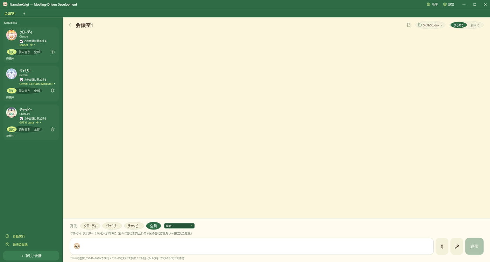
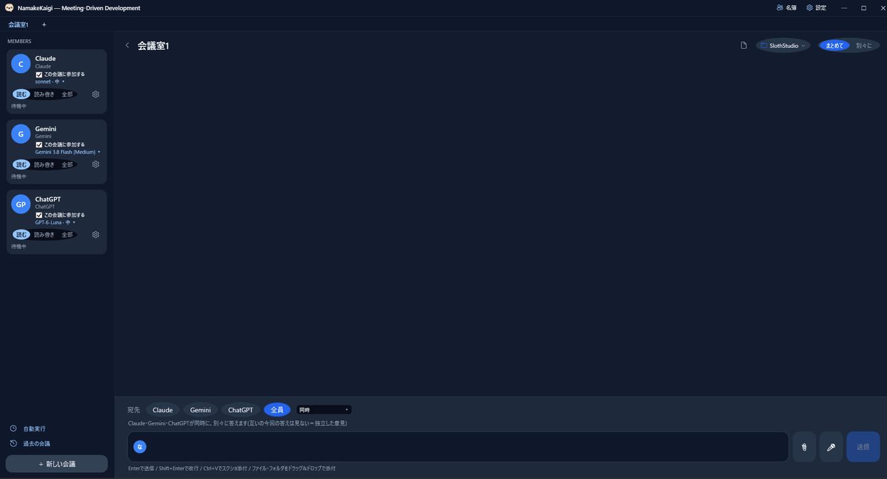

# ナマケ会議 (NamakeKaigi)

> **3大AI（Claude / Gemini / ChatGPT）が1つの会議室で議論・協調作業する「会議駆動開発（MDD）」デスクトップアプリ**



<details>
<summary>イラストなし・オフィス配色の画面</summary>



</details>

---

## 💡 ナマケ会議とは？

ナマケ会議は、**Claude Code**、**Google Antigravity (Gemini)**、**OpenAI Codex (ChatGPT)** の3つの自律型AI CLIツールを同じチャットルームに集め、**まるでチームメンバーと会議するようにソフトウェア開発を進めることができる Windows デスクトップアプリ** です。

従来の1対1のチャットAIでは難しかった、**「Claudeが作った設計にGeminiがツッコミを入れ、ChatGPTが客観的にまとめる」** というような複数AIの協調作業（会議駆動開発：Meeting-Driven Development）を手軽に実現できます。

---

## ✨ 主な特徴

- 👥 **マルチAI会議室**  
  Claude, Gemini, ChatGPT を自由に参加・退出させ、1つの画面で対話可能。
- 🔄 **柔軟な発言順序の制御**  
  「全員が同時に答える」「Claudeが先に答えて、残りがレビューする」「指名した1人だけが答える」をワンクリックで切り替え。
- 🛡️ **安全な3段階の権限モード**  
  AIに与える権限をボタン1つ（**読む** / **読み書き** / **全部**）で直感的に切り替え。
- 📝 **Markdown会議録の自動保存**  
  会話の内容や添付ファイル、各AIの思考・作業ログをローカルのMarkdownファイルとして自動記録。
- 🗂️ **タブによる複数会議の並行管理**  
  トピックごとに複数の会議室タブを開いて作業を切り替え可能。
- 📎 **クリップボード画像・ファイル添付**  
  `Ctrl+V` で画像を貼り付けたり、ファイルをドラッグ＆ドロップしてAIに即座に読ませることが可能。

---

## 📋 必要な環境・前提条件

本アプリは、PCにインストールされた各社の公式CLIツールを裏で呼び出して連携します。

### 1. 動作環境
- **OS**: Windows 10 / 11 (64-bit)
- **ランタイム**: 配布の zip に .NET が同梱されているため、別に入れる必要はありません

### 2. 連携可能なAIツール（いずれか1つ以上）
※3つすべて揃っていなくても、**どれか1つがPCに入っていれば動作します**。

| AI名 | 必要なCLIツール | インストール・準備方法 |
| :--- | :--- | :--- |
| **Claude** | **Claude Code** | `npm install -g @anthropic-ai/claude-code`<br>ターミナルで `claude` を実行して初期ログインを済ませてください。 |
| **Gemini** | **Antigravity (agy)** | [Google Antigravity](https://antigravity.google) をインストールすると同梱される `agy.exe` を使用します。 |
| **ChatGPT** | **Codex CLI** | OpenAI Codex CLI をインストールし、ターミナルでログインを済ませてください。 |

---

## 🔰 はじめ方（使い方）

1. **ダウンロード**  
   [Releases](https://github.com/SlothStudioAI/NamakeKaigi/releases) から最新の `NamakeKaigi-vX.X.X-win-x64.zip` をダウンロードし、お好みのフォルダに解凍します。
2. **起動**  
   フォルダ内の `NamakeKaigi.exe` をダブルクリックして起動します。
3. **作業フォルダの選択**  
   初回起動時に、AIが作業（ファイルの読み書き）を行うプロジェクトフォルダを選択します（あとから画面上でいつでも変更できます）。
4. **会議の開始！**  
   画面下の入力欄にメッセージを入力し、宛先（「全員」「Claude」「Gemini」など）を選んで送信するだけです！

### Windows の警告（SmartScreen）が出たとき

配布ファイルにはデジタル署名がないため、初回起動時に「WindowsによってPCが保護されました」と表示されることがあります。次の手順で起動できます。

1. 警告画面の **「詳細情報」** をクリックします。
2. 表示された **「実行」** ボタンをクリックします。

---

## 🔒 3つの権限モード（安全設計）

画面左の参加者カードから、各AIに許可する権限を切り替えられます。

| 段階 | 許可される操作 | 安全性・用途 |
| :---: | :--- | :--- |
| **読む** | ファイルの閲覧・検索のみ | **【最高】** すべてのAIでファイル変更・コマンド実行を制限。調査・雑談・アイデア出しに。 |
| **読み書き** | ファイルの作成・編集<br>*(※AIにより挙動が異なります)* | **【中〜高（AIにより差異あり）】** コードや文書の作成を任せたいときに。<br>・**Claude**: コマンド実行不可。作業フォルダ内のみ編集可能。<br>・**ChatGPT**: 作業フォルダ内に限り、編集およびコマンド実行が可能。<br>・**Gemini**: アプリから「外には書かない」「コマンド不可」を指示（※仕組み上は外部フォルダへの書き込みも可能なため、画面上に注意が表示されます）。 |
| **全部** | コマンド実行（ビルド・テスト等）も含む全操作 | **【制限なし】** コマンドも含めて自律的に実装・バグ修正を一貫して任せたいときに。 |

### 各CLIに渡される起動引数（既定値）

選択された権限段階に応じて、アプリが各CLIを呼び出す際に以下の引数を付与し、制限を適用します（設定ファイル `settings.json` で変更可能です）。

| 段階 | Claude Code | Gemini (Antigravity / agy) | ChatGPT (Codex CLI) |
| :---: | :--- | :--- | :--- |
| **読む** | `--disable-slash-commands`<br>`--strict-mcp-config`<br>`--tools Read,Glob,Grep` | `--mode plan` | `-c sandbox_mode=read-only`<br>`--skip-git-repo-check` |
| **読み書き** | `--disable-slash-commands`<br>`--strict-mcp-config`<br>`--tools Read,Edit,Write,Glob,Grep`<br>`--permission-mode acceptEdits` | `--mode accept-edits` | `-c sandbox_mode=workspace-write`<br>`--skip-git-repo-check` |
| **全部** | `--permission-mode auto` | `--dangerously-skip-permissions` | `-c sandbox_mode=danger-full-access`<br>`--skip-git-repo-check` |

---

## 🗂️ 設定と、読み書きするファイル（プライバシー）

### 通信について
- アプリ自体は、外部のサーバーへ通信しません。会話内容を外部へ独自に送ることもありません。
- 裏で呼び出される各AIのCLIツール（`claude` / `agy` / `codex`）は、それぞれのツールの仕様で各社のサーバーと通信します。

### 読み書きするもの
- **アプリの設定**: `%APPDATA%\NamakeKaigi\settings.local.json`（既定値はアプリ同梱の `settings.json` から読み、変更分だけをここに保存します）
- **モデル一覧のキャッシュ・エラー記録**: `%APPDATA%\NamakeKaigi\agy-models.json`、`%APPDATA%\NamakeKaigi\error.log`
- **会議録と添付ファイル**: アプリの `meetings/` フォルダ（会話の内容・添付画像を Markdown と JSON で保存します）
- **自動実行（スケジュール）の設定と履歴**: アプリの `schedule/schedule.json`、`schedule/schedule-history.jsonl`
- **作業フォルダ内のファイル**: AIに「読み書き」「全部」の権限を渡したときのみ、各AIのCLIがファイルの作成・編集を行います。

### 読むだけのもの
- 「名簿」画面を開いたとき、作業フォルダおよびホームフォルダ（`%USERPROFILE%`）内のメンバー定義（`.claude/agents`、`.codex/agents`、`.agents/skills`）とルールファイル（`CLAUDE.md`、`GEMINI.md`、`AGENTS.md`）を読み取って一覧表示します。アプリからこれらを書き換えることはありません。

---

## 🛠️ ソースからビルドする

Windows 専用です。ソースからビルド・テストする場合は .NET 10 SDK が必要です。  
内部の仕組みやフォルダ構成については、[設計メモ (docs/DESIGN.md)](docs/DESIGN.md) を参照してください。

```powershell
git clone https://github.com/SlothStudioAI/NamakeKaigi.git
cd NamakeKaigi
dotnet build src/NamakeKaigi/NamakeKaigi.csproj
dotnet test src/NamakeKaigi.Tests
```

### 配布zipを作る

```powershell
./scripts/build_release_zip.ps1
```

自己完結型（`win-x64`・シングルファイル）で `dotnet publish` し、`release/NamakeKaigi-v<バージョン>-win-x64.zip` を生成します。

---

## 🎨 画像について

同梱のキャラクターイラストとアプリアイコンは、AI（Gemini）で生成した画像です。キャラクターは独自の創作で、第三者の権利との関係はありません。画像も含めて、リポジトリ全体が MIT ライセンスです。

## ⚠️ 商標・免責事項

- Claude / Claude Code は Anthropic の商標です。Gemini / Antigravity は Google の商標です。ChatGPT / Codex は OpenAI の商標です。
- 本アプリは、各AIサービス（Anthropic, Google, OpenAI）の公式CLIツールを裏で呼び出す**非公式のクライアントソフト**であり、各社とは無関係です。
- 本ソフトウェアは「AS IS（現状のまま）」で提供されます。AIに「読み書き」「全部」の権限を渡すと、ファイルの書き換えやコマンドの実行が行われます。重要なフォルダではバックアップや Git 管理を行ったうえ、「読む」段階から始めてください。
- 各社による外部CLIの仕様変更やアップデートに伴い、一時的に動作が不安定になる場合があります。
- 不具合報告や機能要望は、GitHubの [Issues](https://github.com/SlothStudioAI/NamakeKaigi/issues) までお気軽にお寄せください！

---

## 📄 ライセンス

本ソフトウェアは [MIT License](LICENSE) の下で公開されています。  
利用しているサードパーティのソフトウェアについては、[THIRD-PARTY-NOTICES.md](THIRD-PARTY-NOTICES.md) を参照してください。

---

## 🌐 English summary

- **What it is**: A Windows desktop app for **Meeting-Driven Development (MDD)** that brings Claude Code, Google Antigravity (`agy`), and OpenAI Codex CLI into a single chat room so multiple AIs can discuss, review, and collaborate.
- **Requirements**: Windows 10/11 (64-bit). The release zip is self-contained (no .NET install needed); building from source requires the .NET 10 SDK. At least one supported AI CLI (`claude`, `agy`, or `codex`) must be installed.
- **Quick start**: Download the zip from [Releases](https://github.com/SlothStudioAI/NamakeKaigi/releases), extract it, and run `NamakeKaigi.exe`. If Windows SmartScreen appears, click "More info" then "Run anyway".
- **Privacy & safety**: The app itself makes no external network connections; it only invokes your local AI CLIs and saves meeting logs locally under `meetings/` and user settings under `%APPDATA%\NamakeKaigi`. Each AI's permission level (**Read** / **Read-Write** / **Full**) can be switched per turn. Back up important files or use Git before granting write or command permissions.
- **License**: [MIT](LICENSE) (see [THIRD-PARTY-NOTICES.md](THIRD-PARTY-NOTICES.md)). Unofficial client tool, not affiliated with Anthropic, Google, or OpenAI ("AS IS").
